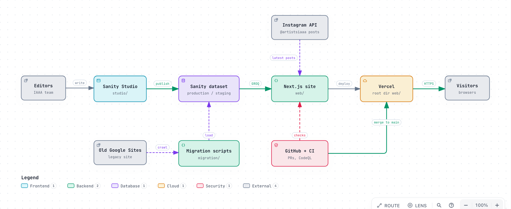
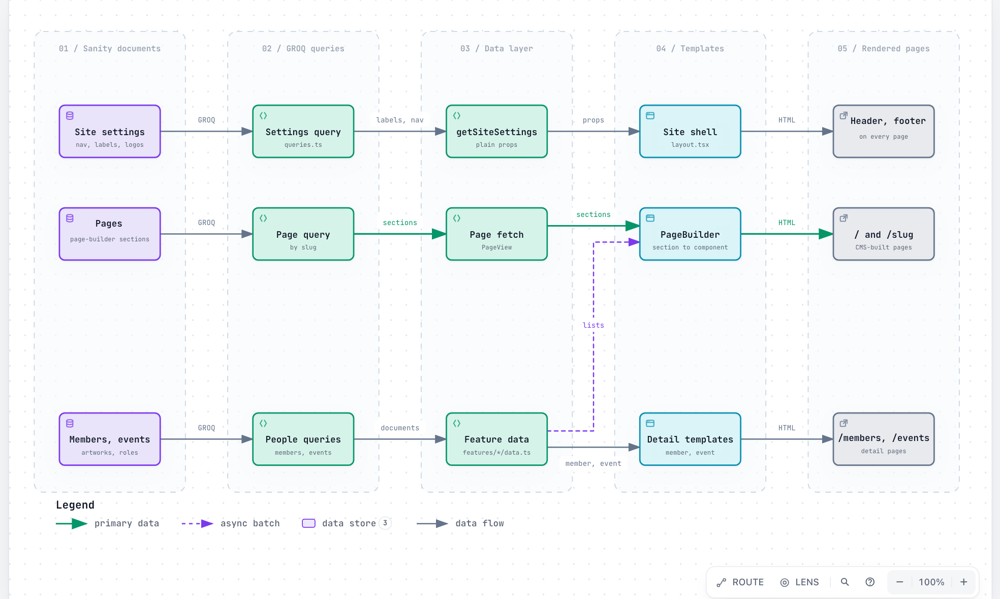
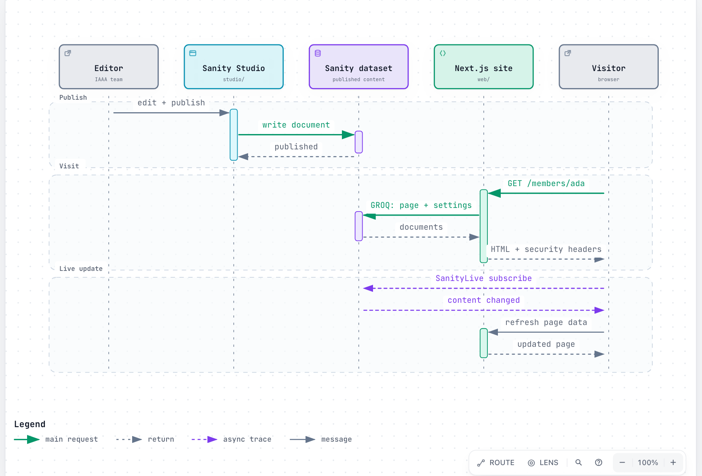

# IAAA Website

Website of the [Indian American Artists Association](https://www.indianamericanartists.org): a community of Indian-origin visual artists creating, exhibiting and building connections across the United States.

The site is a Next.js app whose content is managed entirely in Sanity. Every page's text, labels, links, images and logos are edited in the Studio, with no code changes.

## Repository layout

| Folder | What it is |
|---|---|
| [`web/`](./web) | The public website: Next.js 16, React 19, Tailwind 4 |
| [`studio/`](./studio) | Sanity Studio: content schemas and seed scripts (project `jh3pdn6m`, dataset `production`) |

## Quick start

Requires Node 20+ and a Sanity login with access to the project.

```bash
# 1. Website
cd web
cp .env.example .env.local
npm install
npm run dev            # http://localhost:3000

# 2. Content Studio (second terminal)
cd studio
npx sanity login       # once
npm install
npm run dev            # http://localhost:3333
```

Publish a change in the Studio and it shows up on the site within about a minute.

## Architecture

Three diagrams, made with [Archify](https://github.com/tt-a1i/archify) from the source code. Each image links to an **interactive version** (hover to trace a route, search nodes, switch light/dark, export as PNG/SVG). The HTML files in [`docs/architecture/`](./docs/architecture) are standalone, so you can also download one and open it in a browser.

### System overview: from editor to visitor
Editors publish in Sanity Studio; the Next.js site reads the published content and is deployed on Vercel. Pull requests and CI gate every change to `main`, the Instagram API feeds the home page, and the migration scripts moved the old Google Sites content into Sanity.

[](https://htmlpreview.github.io/?https://github.com/OUTATIME-FANBOYS/IAAA-Website/blob/main/docs/architecture/system-overview.html)

[Open the interactive diagram](https://htmlpreview.github.io/?https://github.com/OUTATIME-FANBOYS/IAAA-Website/blob/main/docs/architecture/system-overview.html)

### Content flow: Sanity to page
How a Sanity document becomes a page: documents, GROQ queries, the data layer, templates, and the rendered pages. Pages are data: a Page document's slug is its URL, and its sections decide what renders.

[](https://htmlpreview.github.io/?https://github.com/OUTATIME-FANBOYS/IAAA-Website/blob/main/docs/architecture/content-flow.html)

[Open the interactive diagram](https://htmlpreview.github.io/?https://github.com/OUTATIME-FANBOYS/IAAA-Website/blob/main/docs/architecture/content-flow.html)

### Publish, visit and live update
What happens when an editor publishes, when a visitor loads a page, and when an open page hears about a change.

[](https://htmlpreview.github.io/?https://github.com/OUTATIME-FANBOYS/IAAA-Website/blob/main/docs/architecture/publish-and-visit.html)

[Open the interactive diagram](https://htmlpreview.github.io/?https://github.com/OUTATIME-FANBOYS/IAAA-Website/blob/main/docs/architecture/publish-and-visit.html)

<details>
<summary>Regenerating the diagrams</summary>

The diagram definitions are in [`docs/architecture/source/`](./docs/architecture/source) and cite the files and lines they describe, pinned to a commit. After a significant change to the structure, update the JSON and rebuild with the Archify skill (`npx skills add tt-a1i/archify -g`), for example:

```bash
node ~/.claude/skills/archify/bin/archify.mjs finalize architecture \
  docs/architecture/source/system-overview.architecture.json \
  docs/architecture/system-overview.html --repo-root . --quality showcase
```

</details>

## Where to read more

- [`web/README.md`](./web/README.md): how content maps to pages, page-builder sections, environment variables, scripts, deploying
- [`web/ARCHITECTURE.md`](./web/ARCHITECTURE.md): folder structure and dependency rules
- [`web/DESIGN_SPEC.md`](./web/DESIGN_SPEC.md): colors, fonts and page layouts
- [`studio/README.md`](./studio/README.md): content model and seed scripts

## Deploying

Deploy `web/` to Vercel (set **Root Directory** to `web`, add the environment variables from `web/.env.example`, and add the Vercel domain to the Sanity CORS origins). Deploy the Studio with `npx sanity deploy` from `studio/`. Pushes to `main` publish to production.
